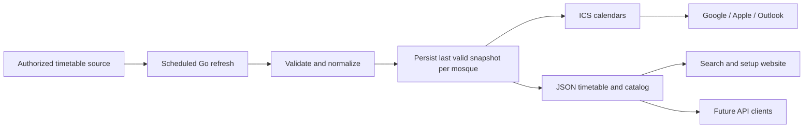

# Next version proposal

Status: proposal, 2026-10-12. Audience choice and scope are not yet confirmed.

## Outcome

Someone finds their mosque, subscribes to its calendar, and sees the prayer
events on their phone without asking the maintainer for help.

Recommended first audience: people using calendars. A Go library and a JSON
API can support that same product as it grows; each uses the same timetable
model rather than maintaining separate prayer-time logic.

## What exists

- Go CLI with mosque search and generation for multiple mosque slugs.
- Mosque timetables, iqama, Friday prayers, stable event UIDs and UTC ICS output.
- Daily GitHub Pages deployment; the workflow currently generates Sahaba only.
- All code is currently in package main; it is not an importable Go library.
- No public onboarding page exists.

The current failure policy retains the published site when generation fails.
For a larger catalog, preserve each mosque's last valid feed independently so
one failing mosque does not prevent updates for all the others.

## First user journey

1. Open a mobile-friendly page in French, Arabic or English.
2. Search by mosque name, city or postcode. Start with a small curated catalog.
3. Select a mosque using its name and address; preview today's adhan and iqama.
4. Choose Google Calendar, Apple Calendar or Outlook.
5. Follow instructions for that app and subscribe to the updating feed.
6. Complete a phone check: enable the calendar and confirm a prayer is visible.

Keep the feed URL available to copy. Explain subscriptions versus a one-time
download. Calendar applications refresh on their own schedule; do not promise
instant updates or dependable adhan notifications through a subscription.

The phone check is an explicit product requirement from this session: the feed
was present in Google's account, but needed enabling on the phone.

## Release order

### 1. Guided calendar site

Build a responsive page over the existing generated feeds. Begin with curated
mosques and a generated search index, rather than fetching upstream on every
search or user visit. Only display mosques whose feeds are actually published.

Include per-mosque source attribution, timezone, source-fetch time and feed-build
time. Those timestamps must reflect successful operations, not the time a page
was opened. Offer a shareable mosque page and QR code.

Default to the existing event behavior: an event starts at adhan and includes
iqama in its title/details when available. Clearly distinguish a future option
to start at iqama from merely showing iqama in the title.

### 2. Reusable Go library

Extract the timetable model, source adapter, event generation and ICS formatting
into importable packages. Keep network access separate from pure conversion.
The CLI remains a thin client of those packages.

Use a provider interface so authorized Mawaqit integration or mosque-supplied
timetables can feed the same model. Never silently replace a mosque's timetable
with calculated city times; their provenance and meaning differ.

### 3. JSON API

Expose the same verified snapshots used to build the calendars when external
integrations need them. Candidate contracts:

```text
GET /v1/mosques?q=creteil
GET /v1/mosques/{id}/times?date=2026-10-12
GET /v1/mosques/{id}/calendar.ics
```

Responses should carry stable mosque ID, source, IANA timezone, local date,
adhan, nullable iqama, Friday sessions, fetched_at and stale status. Use explicit
timezone offsets on timestamps. Reject invalid dates and bound date ranges;
distinguish unknown mosque, unavailable timetable and stale-but-valid data.

A JSON endpoint can initially be generated static data if those clients only
need published snapshots. Add a Go HTTP service when queries or demand justify
it; the service must serve cached snapshots rather than scrape per request.

## Architecture



For the first release, GitHub Actions and Pages can publish a small catalog,
calendar feeds and static JSON together. Use minimal HTML/CSS/JavaScript for the
site. No sign-in is needed to find a mosque or copy a public subscription URL.

Dynamic hosting becomes justified when users need mosques outside the curated
catalog. Its requirements are bounded upstream fetching, persisted snapshots,
rate limits, background refresh and per-mosque failure isolation.

## Data dependency

ROADMAP.md already makes Mawaqit's agreement a prerequisite for a hosted public
service. Their official help page, checked 2026-10-12, states that their API is
private and invites mosque/integration inquiries:

https://help.mawaqit.net/en/articles/11991838-can-i-use-your-api

Confirm permitted access and redistribution before expanding public coverage
or exposing their data through a public API. Prepare the interface, library and
tests locally while that is unresolved. This proposal does not authorize
contacting Mawaqit or publishing a service.

## Validation and success

- Test timezone/DST behavior, year rollover, missing iqama and multiple Friday
  sessions using fixtures before generalizing the generator.
- Confirm a feed update changes an existing event without duplicates in real
  Google and Apple subscriptions.
- Confirm a failed source update preserves that mosque's previous feed while
  healthy mosques continue updating; expose stale status and alert the operator.
- Have five people outside the maintainer's household attempt onboarding without
  help. Record where they get stuck, including the phone visibility step.
- First milestone: those five people see their own mosque on their phones and
  subscribe in under three minutes. Follow with ROADMAP.md's reliability goal:
  ten users relying on it for thirty days.

## Scope boundaries and later decisions

Keep initial options small. Add prayer selection, languages for event titles,
start-at-iqama, extra events and busy/free preferences after observing demand.
Encode preferences into stable subscription URLs; preserve event identity.

Revisit native apps only if users need behavior calendars cannot provide,
such as controlled notifications. Revisit a separately supported developer API
after real integrations appear. Keep the first milestone measurable and dated
when the audience and release scope are chosen.
